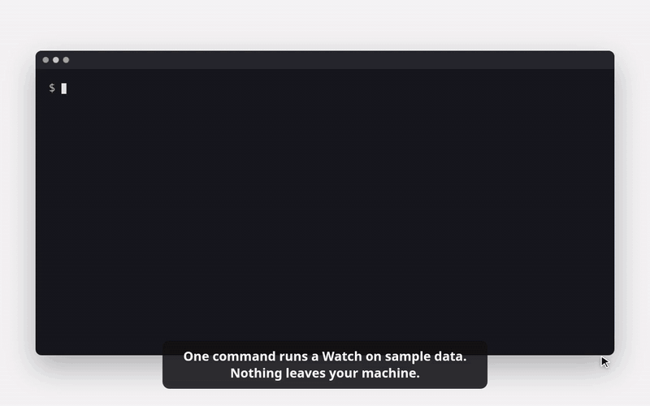
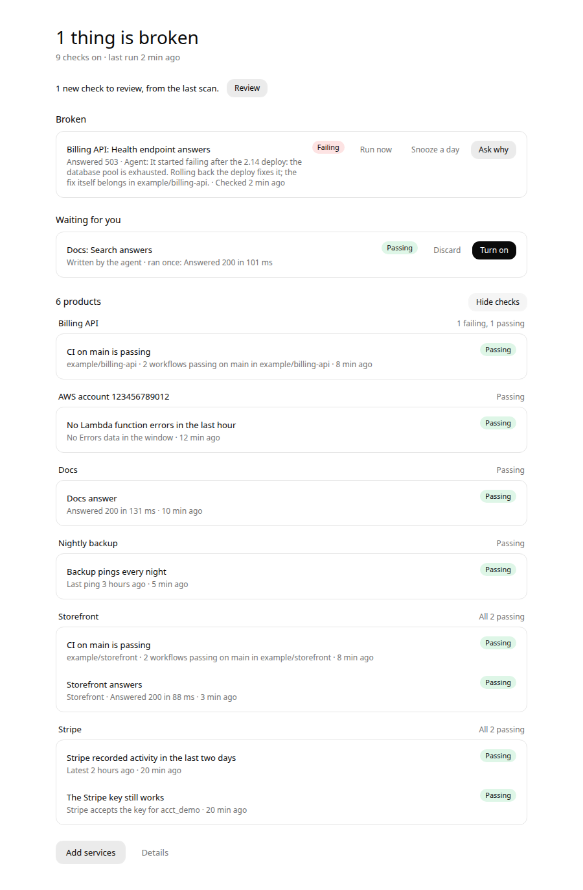
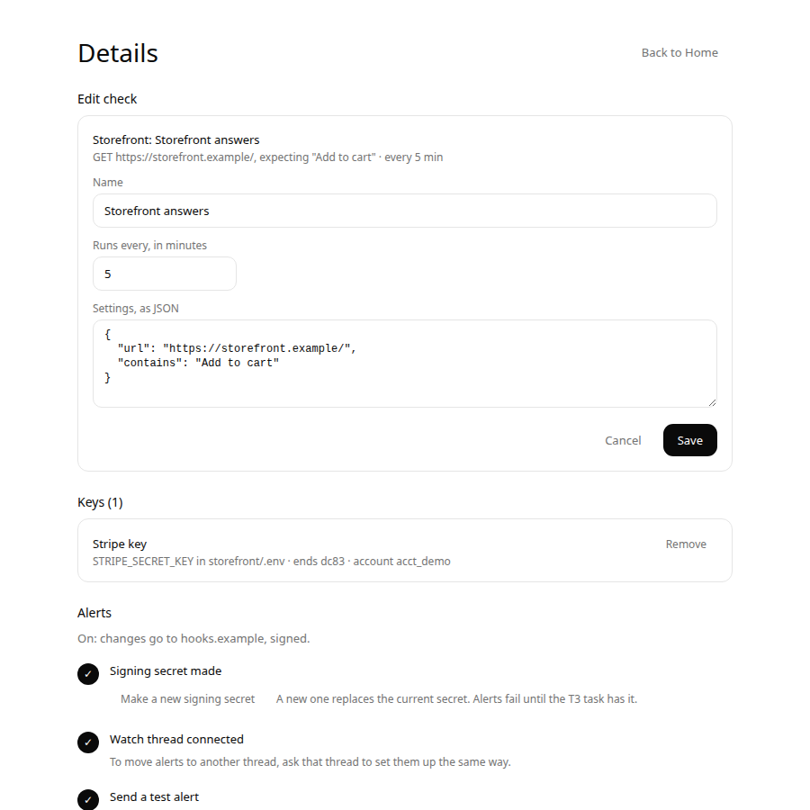

# t3-watch

An agent on call for the things nobody watches. Checks run free; your agent wakes only when
something changes.

Watch keeps an eye on the systems you run: CI, cloud accounts, API keys, URLs and scheduled jobs.
It sets itself up from the projects and logins already on your machine, and runs its checks as
plain code on its own clock, so they spend no model tokens.

- **The page** is for knowing and deciding: what's broken, what's waiting for you, and one-click
  Turn on, Pause and Add key. Keys are pasted here, never in chat. Details edits a check's name,
  how often it runs and its settings, and deletes one; a deleted check keeps its history and can
  be restored.
- **The chat** is for understanding and authoring. A "Watch" thread in [T3 Code](https://t3.codes)
  (or any MCP client) investigates failures, writes new checks and shows the page inline.

[](docs/demo.mp4)

The demo in 60 seconds, recorded from `npx @lfg-labs/t3-watch demo` with its sample data. Click it
for the sharper [MP4](docs/demo.mp4), which GitHub hands over as a download.

## Try it first

```sh
npx @lfg-labs/t3-watch demo
```

With Node 24 or newer, the demo runs a Watch with sample checks on this machine and prints a
sign-in link for its page. Every check and alert in it gets a canned answer, and it neither scans
nor takes keys, so it reaches none of your accounts and sends nothing off the machine. Signing in
to it leaves your own Watch signed in. Ctrl-C stops it and removes it. The video and the
screenshots here come from it.

| Each product with its checks | Editing a check in Details |
| --- | --- |
|  |  |

## Install

Watch needs Node 24 or newer, on a machine that stays on.

```sh
npm install -g @lfg-labs/t3-watch
t3-watch install
```

`install` runs Watch in the background at login (systemd on Linux, launchd on macOS), adds its MCP
server to Codex and Claude Code, and prints a sign-in link for the page. A sign-in link works
once, within 10 minutes, so a copy left in a terminal, a log or a chat is useless after use. For
each other browser, `t3-watch url` prints a new one, or ask your Watch thread for the page. A
browser gets its own session, never the access token agents use, and `t3-watch signout` signs
every browser out while agents keep working.

T3 Code can run several accounts for one provider, each in its own home. `t3-watch install --all`
also adds Watch's MCP server to every enabled Claude Code and Codex home in T3's settings, so a
Watch thread works on any account, and `t3-watch uninstall --all` takes it out of them again.

To run from a checkout instead, clone this repository, run `pnpm install && pnpm build`, then
`node bin/t3-watch.js install`.

On Linux, `loginctl enable-linger $USER` keeps it running while you're logged out.

If Tailscale runs on the machine, `install` serves the page on your tailnet over HTTPS with
`tailscale serve`, never `funnel`, on port 8461 or the next free one, and sign-in links point
there. It opens on your own devices and nowhere else. Tailscale lets only its operator do this:
if install says so, run `sudo tailscale set --operator=$USER` once and install again.
`--no-tailscale` keeps the page on this machine, a `publicUrl` you set in
`~/.t3-watch/config.json` is left as it is, and `uninstall` stops the route install made. If `host`
there is a tailnet address, Watch listens on 127.0.0.1 as well, so `tailscale serve` can front it.

## First run

Open the page. It first shows what Watch may read: the folders it would look in, `~/Projects`
and any of `~/code`, `~/src` and `~/dev` that exist, each with how many git repositories it
holds, and three logins: the GitHub CLI, AWS CLI profiles, and vendor keys in `.env` files.
Untick what Watch should leave alone, add a folder if you like, and press **Scan these**. Watch
reads only what is ticked: it finds the vendors your code uses, tests the logins you allowed, and
runs every suggested check once. Untick the checks you don't want and press **Watch these**.
**Add services** shows the same choice before each later scan, and an agent can read it with
`watch_sources`.

Watch only reads. Keys it finds are stored encrypted in `~/.t3-watch`, and their values never
reach the page, a log or an agent.

## The Watch thread

`install` adds a project named Watch to T3 Code, in a folder of its own with no code, so a thread
there starts without any repository's hooks, skills or memory. Start a thread in it and say "Show
me Watch". The agent calls `watch_home`. On Codex threads the page appears inline and its buttons
work; on other providers you get the same state as text. `install --no-project` skips the
project, and `uninstall` leaves it with its threads.

Things to ask:

- "What's broken?" or "Why did CI fail on api?"
- "Pause the Stripe checks until Monday."
- "Make sure the nightly import ran." The agent drafts a check, runs it once, and leaves it for you
  to turn on.
- "Watch Missive too." The agent writes a vendor description and tests it with your key.
- "Set up alerts." Alerts in the page's Details walks you through three steps. Press **Make a
  signing secret**, which the page shows once. Say "Set up alerts" here: the agent creates a T3
  webhook task bound to the thread that checks Watch's signature, asks you to paste the secret
  into a private T3 card, gives Watch the task's address, and sends a test alert. The task
  accepts it only when it holds Watch's secret. **Send a test alert** on the page, or
  `t3-watch alerts test` in a terminal, sends another whenever you want to check, and
  `t3-watch alerts` says how the last one went. The secret never passes through the chat, Watch
  refuses one sent over MCP, and only the webhook's host shows on the page. From then on, a check that starts failing, recovers or can't
  run wakes the thread, and the agent looks into it before you open it. Checks that keep passing
  send nothing. A check that was passing counts as failing only when two runs in a row do not
  pass; Watch runs it again within a minute of the first, so one dropped request wakes nobody. A
  recovery counts at once.

## When Watch's own connection drops

When a check that needs the internet stops passing, Watch first asks whether it can reach the
internet at all. If neither `https://www.gstatic.com/generate_204` nor
`https://one.one.one.one/cdn-cgi/trace` answers within 5 seconds, it holds the result: the run
shows in the check's history as held, the check keeps its last result, and nothing alerts. Home
and the Watch thread's status say when Watch lost its connection. Heartbeats and checks on this
machine are never held, and a check's failures are held for at most an hour of its runs in a row,
in case the probe addresses are what is blocked.

A slow link gets the same care. When a web or vendor check's connection to a public site times
out, drops or cannot finish its name lookup, Watch times its probe. One that takes
a second or more, or 400 ms or more while two or more sites newly fail that way within two
minutes, means Watch's own link is slow, and the failure is held like an offline one. A refused
connection, a bad certificate, an HTTP answer, GitHub and AWS checks, and checks on your own
network, by address or by a name such as nas or fritz.box, still count. A check's next run after a held one waits 45 seconds for an answer instead
of 15. Home and the Watch thread's status say when the connection turned slow; the spell ends when
a probe or a request answers within 400 ms, or a probe no longer shows it slow.

If your network blocks those two addresses, list ones it allows as `probeUrls` in
`~/.t3-watch/config.json` and restart Watch. An empty list turns holding off. Watch notices a
blocked list on its own: when the addresses fail twice in an hour right after a check reached the
internet, it stops holding and says so on Home until one of them answers or Watch restarts. A
web request that had just taken longer than the probes wait is the exception: then the link is
slow, not the list blocked.

## Vendors

Each vendor is a JSON file in [`catalog/`](catalog): how to spot it in a project, which variable
holds its key, how to send the key, which read-only call proves the key works, and which checks
to offer. Adding a vendor is a file, not a release. Watch only sends GET requests to the API
origin a description names.

Shipped: Stripe, Pipedrive, Missive, Asana, Airtable, Jotform, Calendly, Vimeo, Sentry, OpenAI,
Anthropic. Xero is recognised, but sign-in vendors aren't supported yet.

Check kinds that need no vendor file: `http`, `github` (through `gh`; for a scheduled workflow, name
it in `workflow` and add `maxAgeSeconds`, so a schedule GitHub skipped or disabled fails instead of
staying green),
`aws_metric` (through the AWS CLI) and `heartbeat` (a job pings a URL; add `?status=fail` when it
fails).

## Development

```sh
pnpm dev          # the service from source, on 127.0.0.1:8460
pnpm test         # unit and integration tests
pnpm typecheck
pnpm build        # server, page and the inline view
node scripts/record-demo.ts   # the README's demo video again, with Chrome and ffmpeg
```

Design and requirements live in [`openspec/`](openspec).

## License

Free and open source under the [MIT license](LICENSE).
